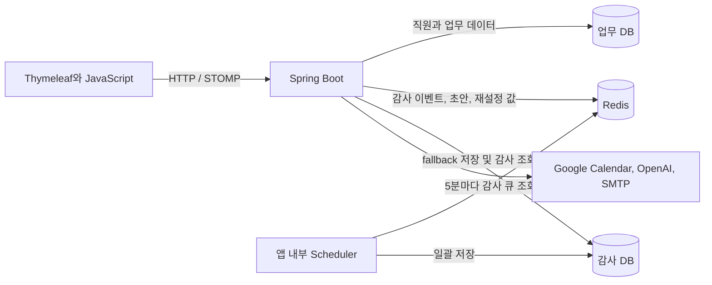

# Office Mate

Office Mate는 직원이 프로젝트 업무와 일정을 관리하고 게시판과 채팅으로 협업하는 사내 그룹웨어입니다. 2026년 4월부터 5월까지 4명이 함께 개발했습니다.

JWT 인증과 직원 계정 관리, 감사 로그를 담당했습니다. 휴직이나 퇴사가 승인된 직원은 기존 토큰으로 보호된 업무 API를 호출할 수 없도록 했습니다. 직원 정보나 권한을 변경한 관리자는 감사 로그에서 확인할 수 있습니다.

## 담당 기능과 설계

### 재직 상태와 API 접근 권한

로그인 직후 휴직이 승인되면 이미 발급한 Access Token에는 최대 30분의 유효기간이 남습니다. 변경된 상태를 즉시 반영하기 위해 `TokenCheckFilter`에서 보호 대상 HTTP API 요청마다 사번으로 재직 상태, 역할, 잠금 여부를 조회하도록 했습니다. 역할 회수도 바로 반영할 수 있지만, 요청마다 업무 DB를 읽는 비용이 생깁니다. 휴직이나 퇴사 후에도 로그아웃은 허용합니다. 채팅의 STOMP 연결은 별도의 인증 경로를 사용합니다.

직원 등록과 정보 수정, 논리 삭제를 구현하고 휴직, 복직, 퇴사 신청은 SUPER가 승인하거나 반려하도록 했습니다. 비밀번호 변경과 재설정, 로그인 실패 횟수에 따른 계정 잠금, 관리자의 잠금 해제도 담당했습니다.

### 토큰 재발급과 폐기

Access Token의 유효기간은 30분, Refresh Token은 30일로 설정했습니다. 장기간 사용하는 Refresh Token은 HttpOnly 쿠키로 전달하고 DB에는 해시만 저장했습니다. 로그아웃하면 해당 사번의 Refresh Token을 폐기합니다. 이미 발급한 Access Token은 개별적으로 폐기하지 않습니다. 두 토큰의 용도를 구분하는 검사와 재발급 시점의 계정 잠금 확인은 보완할 부분입니다.

### 감사 로그 수집과 조회

로그인 결과와 직원 권한 변경처럼 추적이 필요한 행위를 Redis 큐에 기록하고, Scheduler가 감사 DB에 일괄 저장하도록 했습니다. Redis에 쓰지 못하면 감사 DB의 fallback 테이블에 원본을 저장합니다. SUPER는 이관된 로그를 조건별로 검색하고 상세 내용을 확인하거나 CSV로 내려받을 수 있습니다.

감사 DB 저장과 Redis 큐 정리는 별개로 실행됩니다. DB에 저장한 직후 큐 정리가 실패하면 같은 이벤트가 다시 들어갈 수 있습니다. Redis와 감사 DB에 모두 쓰지 못하면 복구할 원본을 잃을 수 있습니다.

## 테스트와 남은 검증

| 실행 범위 | 결과 |
| --- | --- |
| 전체 테스트 | 캘린더와 채팅 테스트 코드의 컴파일 오류로 `./gradlew test`가 JUnit 실행 전에 멈췄습니다. |
| 담당 기능 테스트 | 같은 커밋에서 담당 테스트만 분리해 실행했습니다. 직원 10건, 감사 로그 4건, BCrypt 5건이 모두 통과했습니다. 직원 테스트는 PostgreSQL을, 감사 로그 테스트는 모의 객체를 사용했습니다. |

테스트는 로컬에서 실행했습니다. 감사 로그 테스트에서 확인한 범위는 Redis 쓰기 실패 시 fallback 호출과 이관 서비스의 처리 흐름입니다. 실제 Redis 장애 후 DB에 기록되는 과정은 통합 검증이 남아 있습니다. 배포와 부하 시험은 진행하지 않았습니다.

비밀번호 변경 화면과 서버의 최소 길이 기준이 달랐던 문제는 서비스의 검증 조건을 수정해 맞췄습니다.

우선 검증할 부분은 휴직 승인 전후에 같은 Access Token으로 보호 API를 호출했을 때의 응답입니다. 감사 로그에서는 DB 저장 후 큐 정리에 실패하는 경우를 검증하고, 재시도 시 같은 이벤트가 중복 저장되지 않도록 보완할 필요가 있습니다. 기기별 세션 관리, 세부 권한과 승인 절차, 이상 행위 통계와 알림은 이후 개선 과제입니다.

## 시스템 구성

Spring Boot 애플리케이션이 HTTP 요청과 STOMP 메시지를 처리합니다. PostgreSQL 16 한 인스턴스 안에서 업무 DB와 감사 DB를 구분했습니다. Redis 7.2는 감사 큐, 채팅 초안, 비밀번호 재설정 값에 사용합니다.



Java 21과 Spring Boot 3.5.14를 사용했습니다. 서버에는 Spring MVC, Security, AOP, Scheduling, WebSocket/STOMP, Spring AI를 적용했고, 화면은 Thymeleaf Layout Dialect, JavaScript, Axios로 구성했습니다. 직원과 상태 신청은 Spring Data JPA로 관리하고, 프로젝트 조회에는 MyBatis를, 토큰 관리와 감사 로그 일괄 저장에는 JdbcTemplate을 사용했습니다.

팀 개발을 마친 뒤인 2026년 9월에는 Docker Compose로 PostgreSQL과 Redis의 로컬 실행 환경을 구성하고, Flyway로 업무 DB와 감사 DB의 스키마와 예시 데이터를 관리하도록 개선했습니다. 프로젝트는 Gradle Wrapper로 빌드하며 Lombok, ModelMapper, Gson, Springdoc OpenAPI, JUnit 5, Mockito를 사용했습니다.

### 팀 전체 기능

| 영역 | 주요 기능 |
| --- | --- |
| 프로젝트와 대시보드 | 프로젝트와 멤버 관리, 업무 할당과 진척도 변경, 마감 또는 지연 업무 확인, 알림 읽음 처리 |
| 캘린더 | 개인 일정과 프로젝트 일정 관리, 프로젝트 업무 일정 조회, Google Calendar로 내보내기 |
| 게시판 | 공지, 자유, 프로젝트 게시글 검색과 페이징, 댓글과 첨부파일 관리 |
| 채팅과 AI | WebSocket/STOMP 채팅, Redis 초안 저장, OpenAI를 이용한 업무 질의와 대화 요약 |
| 직원 관리와 보안 | 조직도 조회, 직원 등록과 상태 변경, 역할별 API 접근, 계정 잠금 해제, 감사 이력 검색과 CSV 출력 |

인증 필터는 `security`, 직원 관리는 `common/employee`, 비밀번호와 잠금 처리는 `management/auth`, 감사 로그는 `management/audit_log`에 구현했습니다. 팀의 협업 기능은 `project`, `dashboard`, `board`, `calender`, `chat` 패키지에 있습니다.

## 로컬 실행

1. JDK 21과 Docker Compose를 준비하고 저장소 루트에서 `cp .env.example .env`를 실행합니다. Spring Boot도 이 위치의 `.env`를 읽습니다. [환경변수 예시](.env.example)
2. 기본 Compose는 PostgreSQL 계정 하나로 두 DB를 만듭니다. `DB_USERNAME`과 `DB_PASSWORD`를 설정하고 `AUDIT_DB_USERNAME`과 `AUDIT_DB_PASSWORD`에도 같은 값을 입력합니다. 별도 감사 계정을 사용하려면 해당 DB에 사용자와 권한을 먼저 구성합니다.
3. `JWT_SECRET`에는 32바이트 이상의 임의 비밀값을, `UPLOAD_PATH`에는 쓰기 가능한 절대 경로를 지정합니다. Windows에서는 `C:/upload`처럼 입력할 수 있습니다. 메일 발송과 AI 응답에는 유효한 `MAIL_USERNAME`, `MAIL_PASSWORD`, `OPENAI_API_KEY`가 필요합니다.
4. Google Calendar 내보내기를 사용하려면 OAuth 클라이언트 파일을 `src/main/resources/credentials.json`에 두고 리디렉션 URI `http://localhost:8080/api/calendar/callback`을 등록합니다.

```bash
docker compose up -d postgres redis
docker compose ps
./gradlew bootRun
```

PostgreSQL과 Redis가 준비된 뒤 앱을 시작합니다. 새 볼륨에서는 초기화 SQL이 `office_mate_2605`와 `office_mate_audit_log`를 생성하고, 앱을 시작하면 Flyway가 각 DB에 V1 스키마와 V2 예시 데이터를 적용합니다. 기존 볼륨에서는 초기화 SQL이 다시 실행되지 않으므로 두 DB가 있는지 확인합니다.

실행 후 브라우저에서 프로젝트 화면과 API 명세를 열 수 있습니다. [로컬 화면](http://localhost:8080), [Swagger UI](http://localhost:8080/swagger-ui/index.html)

## 상세 문서

- 설계 판단은 [JWT 계정 상태 검증](docs/adr/ADR-001-jwt-account-state.md), [Refresh Token 관리](docs/adr/ADR-002-refresh-token.md), [감사 로그 아키텍처](docs/adr/ADR-003-audit-architecture.md)에 정리했습니다.
- 구현 흐름은 [인증과 권한 검사](docs/technical/TS-001-authentication.md), [직원 상태 관리](docs/technical/TS-003-employee-lifecycle.md), [감사 로그 처리](docs/technical/TS-002-audit-pipeline.md)에서 확인할 수 있습니다.
- 테스트 결과와 수정 사례는 [테스트 재현 절차](docs/testing/TESTING.md), [비밀번호 최소 길이 기준 수정](docs/troubleshooting/password-length-validation.md)에 정리했습니다.
